# Ambient Backdrop

Animated, weather-aware backgrounds for Home Assistant dashboards. One invisible card puts a live canvas animation behind your whole dashboard.

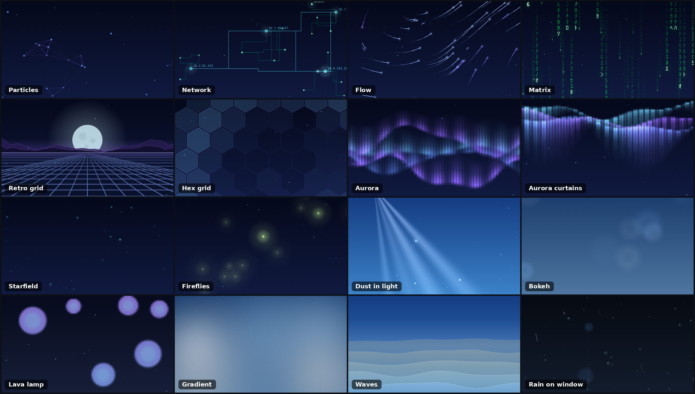

- **16 styles:** particles, network, flow, matrix, retro grid, hex grid, aurora, aurora curtains, starfield, fireflies, dust in light beams, bokeh, lava lamp, gradient, waves and rain on window
- **Weather overlay:** rain with depth, downpour, thunderstorm (branching lightning and afterglow), snow (soft flakes and crystals, drifting in gusts), fog and stars on a clear night sky
- **Reacts to weather and day/night** through a `weather.*` entity and `sun.sun`, with smooth color transitions
- **Your own background underneath:** the theme background, an image or an mp4 video in a loop, with dimming and blur. The animation lies transparently on top
- **Visual editor** with separate settings for every style. The editor is available in English and Danish and follows the Home Assistant language
- **Gentle on hardware:** FPS cap, fewer objects on mobile, automatic scaling down on slow devices, pause in hidden tabs, and respect for "reduce motion"

No external files or CDN links. Everything is drawn with canvas.

## Previews

The animations below are recorded from the card itself.

| | | |
|---|---|---|
| 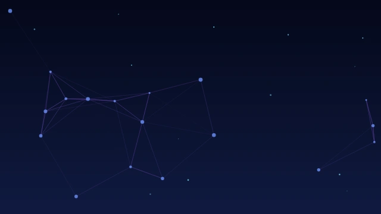 | 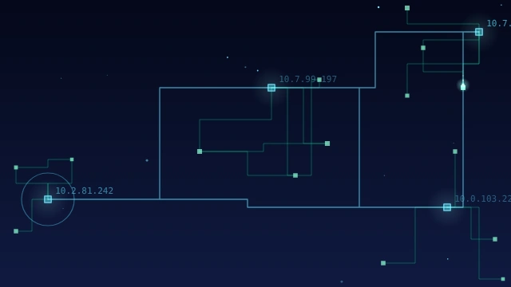 | 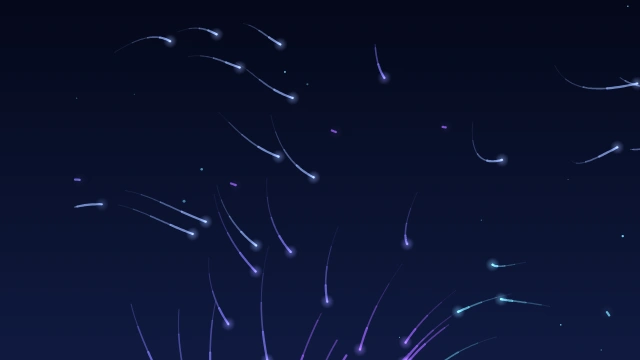 |
| Particles | Network | Flow |
| 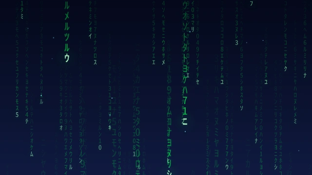 | 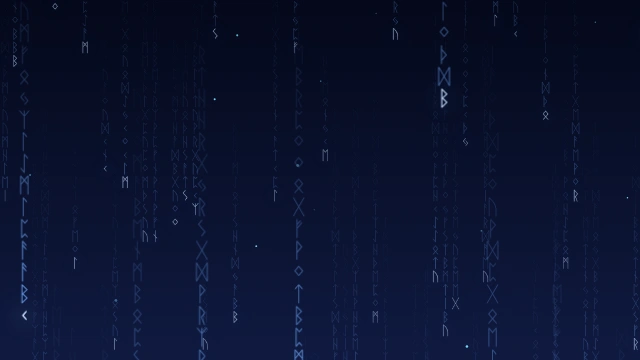 | 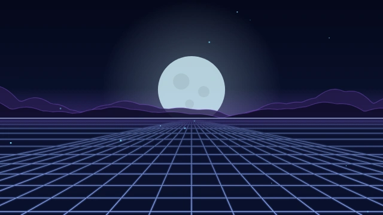 |
| Matrix | Matrix with runes | Retro grid |
| 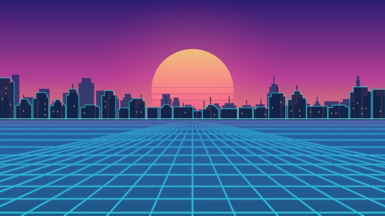 | 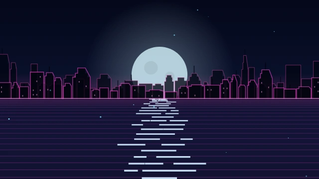 |  |
| Retro, Miami colors | Retro sea | Hex grid |
| 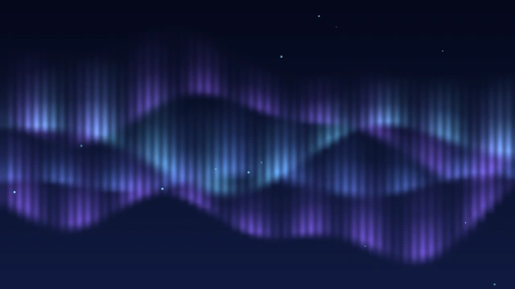 | 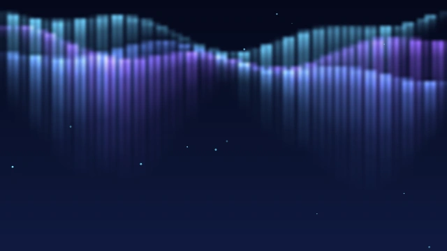 | 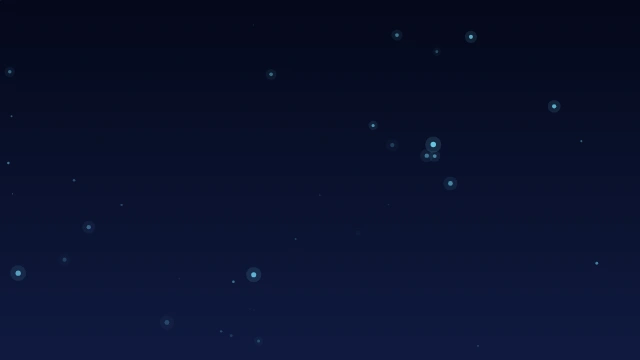 |
| Aurora | Aurora curtains | Starfield |
| 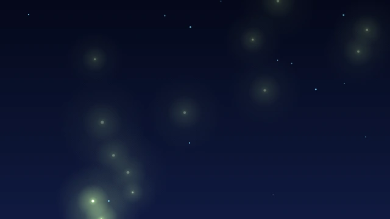 |  |  |
| Fireflies | Dust in light | Bokeh |
| 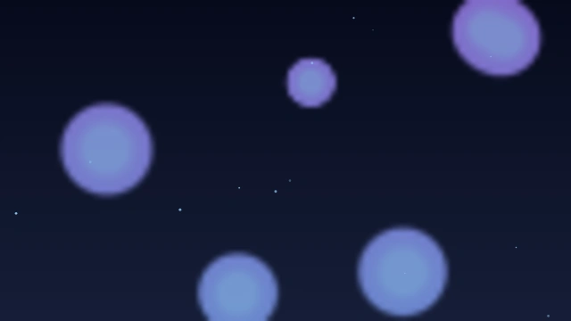 |  | 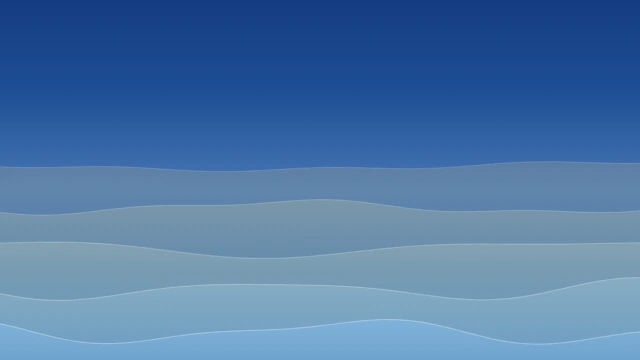 |
| Lava lamp | Gradient | Waves |
| 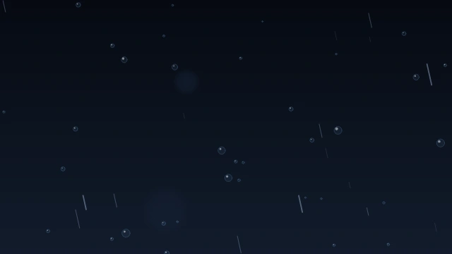 | 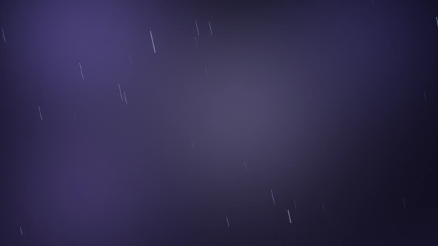 | 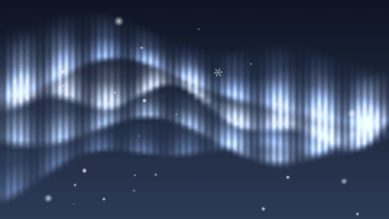 |
| Rain on window | Thunderstorm overlay | Snow overlay |

If the animations do not play where you read this, here is a [GIF version](https://raw.githubusercontent.com/oreskov/ambient-backdrop-card/main/images/demo.gif).

---

## Installation

### With the Marketplace (Home Assistant 2026.11 or later)

[](https://my.home-assistant.io/redirect/hacs_repository/?owner=oreskov&repository=ambient-backdrop-card&category=plugin)

Or do it by hand:

1. Open **Settings → Marketplace**.
2. Choose **Add from link** and enter `https://github.com/oreskov/ambient-backdrop-card`. Adding a repository this way requires signing in to GitHub with a device code. It only reads public information.
3. Find **Ambient Backdrop** and install it.
4. Reload the page with the cache cleared (Ctrl+F5). In the mobile app: Settings → Companion app → Clear frontend cache.

### With HACS (older Home Assistant versions)

1. Open HACS, open the menu (⋮) and choose **Custom repositories**.
2. Add `https://github.com/oreskov/ambient-backdrop-card` with the category **Dashboard**.
3. Download **Ambient Backdrop** and reload the page with the cache cleared.

Both place the file in `/config/www/community/ambient-backdrop-card/` and register the resource themselves. If you manage dashboard resources in YAML, they cannot add it for you. The install dialog then shows what to add manually, or follow the manual steps below.

### Manually

1. Copy `ambient-backdrop-card.js` to `/config/www/` (or a folder under it).
2. Go to **Settings → Dashboards → ⋮ (top right) → Resources → Add resource**
   - URL: `/local/ambient-backdrop-card.js`
   - Type: **JavaScript module**
3. Reload the page with the cache cleared.

### Add the card

Edit the dashboard, choose **Add card**, and search for **Ambient Backdrop**. Or add a manual card with YAML:

```yaml
type: custom:ambient-backdrop-card
style: particles
weather_entity: weather.YOUR_WEATHER_ENTITY
```

Replace `weather.YOUR_WEATHER_ENTITY` with a weather entity from your own setup. More examples are in [`example.yaml`](example.yaml).

### Where should the card go?

The card is invisible when you are not editing. The background runs only on the dashboards and views where the card exists. If you have several views, add the card to each view. Switching between views that have the card does not make the background blink.

---

## Settings

Everything can be set in the visual editor. These are the YAML names:

### General
| Setting | Default | Description |
|---|---|---|
| `style` | `particles` | `particles`, `network`, `flow`, `matrix`, `retro`, `hex`, `aurora`, `curtains`, `starfield`, `fireflies`, `dust`, `bokeh`, `lava`, `gradient`, `waves`, `rainwindow` |
| `weather_entity` | empty | A `weather.*` entity. Empty = no weather reaction (clear weather) |
| `sun_entity` | `sun.sun` | Used for day/night. If it is missing, the clock is used (night 20-07) |
| `animation_enabled` | `true` | Turn off to show only the background/video. The weather overlay has its own switch (`weather_overlay`). If both are off and a background is selected, drawing stops completely |
| `opacity` | `0.85` | Opacity of the animation itself |
| `speed` | `1` | Speed (0.2-3) |
| `density` | `1` | Number of particles/objects (0.2-2) |
| `interaction` | `true` | Mouse/touch affects the animation |
| `max_fps` | `40` | FPS cap (15-60) |
| `fill_background` | `true` | Draws a colored background behind the animation |
| `dither` | `true` | Almost invisible noise that removes banding/squares in gradients on large screens. Turn off if an old device stutters |
| `dither_strength` | `1` | Noise strength (0-2). Raise it if you still see bands. Lower it if you see grain |

### Background (behind the animation)
| Setting | Default | Description |
|---|---|---|
| `background_source` | `none` | `none` (the animation's own colored background), `theme` (your theme's background), `image` (your own image), `video` (mp4 in a loop) |
| `background_image` | empty | Path or URL, e.g. `/local/backgrounds/my-image.jpg` |
| `background_video` | empty | Path or URL to an mp4, e.g. `/local/backgrounds/loop.mp4` |
| `background_video_speed` | `1` | Video speed (0.25-2) |
| `background_dim` | `0.25` | Dark layer on top of the background (0-0.9) so particles and weather stand out |
| `background_blur` | `0` | Blur in pixels (0-20) |

When `background_source` is not `none`, the animation's own colored background is not drawn (so it does not cover yours) and the animation lies transparently on top. `fill_background` is only used when the type is `none`.

Put files in `/config/www/` (e.g. `/config/www/backgrounds/my-image.jpg`) and use them as `/local/backgrounds/my-image.jpg`.

### Colors
| Setting | Default | Description |
|---|---|---|
| `color_mode` | `auto` | `auto` follows weather + day/night, `manual` uses your colors |
| `color_primary` | `[79,163,255]` | Manual mode only |
| `color_secondary` | `[170,90,255]` | Manual mode only |

### Weather overlay
| Setting | Default | Description |
|---|---|---|
| `weather_overlay` | `true` | Main switch for all weather effects |
| `rain` / `snow` / `fog` / `stars` | `true` | Each effect on its own |
| `weather_override` | `auto` | Test: `clear`, `partly`, `cloudy`, `rain`, `pour`, `storm`, `snow`, `fog`. Set it back to `auto` afterwards |

### Per style
Styles are listed in the same order as in the editor's dropdown.

| Style | Settings |
|---|---|
| Particles | `particles_line_distance`, `particles_line_opacity`, `particles_size` |
| Network | `network_size`, `network_distance`, `network_rate`, `network_speed`, `network_glow`, `network_shape`, `network_labels`, `network_scan`, `network_color` |
| Flow | `flow_trail`, `flow_speed`, `flow_scale`, `flow_width`, `flow_glow`, `flow_color_dir`, `flow_weather` |
| Matrix | `matrix_charset`, `matrix_custom`, `matrix_font`, `matrix_size`, `matrix_trail`, `matrix_color`, `matrix_head`, `matrix_smooth`, `matrix_glow_style`, `matrix_glow`, `matrix_depth`, `matrix_mirror`, `matrix_variation`, `matrix_mutate` |
| Retro grid | `retro_speed`, `retro_horizon`, `retro_lines`, `retro_sun`, `retro_skyline`, `retro_sea`, `retro_sky`, `retro_glow`, `retro_color` |
| Hex grid | `hex_size`, `hex_grid`, `hex_fill`, `hex_waves`, `hex_ripples` |
| Aurora | `aurora_bands`, `aurora_height`, `aurora_intensity` |
| Aurora curtains | `curtains_layers`, `curtains_height`, `curtains_rays` |
| Starfield | `starfield_size`, `starfield_twinkle`, `starfield_parallax`, `starfield_shooting` |
| Fireflies | `fireflies_size`, `fireflies_glow`, `fireflies_blink`, `fireflies_color` |
| Dust in light beams | `dust_beams`, `dust_angle`, `dust_origin`, `dust_strength`, `dust_motes`, `dust_wind` |
| Bokeh | `bokeh_size`, `bokeh_soft` |
| Lava lamp | `lava_blobs`, `lava_size`, `lava_soft`, `lava_glow` |
| Gradient | `gradient_blobs`, `gradient_size` |
| Waves | `waves_layers`, `waves_height`, `waves_glow`, `waves_foam` |
| Rain on window | `rainwindow_size`, `rainwindow_rate`, `rainwindow_trails`, `rainwindow_lights`, `rainwindow_natural` |

#### About the styles
- **Particles:** drifting particles joined by lines when they are close. `particles_line_distance` is how close they must be to connect.
- **Network:** hubs with branches of small nodes, circuit-board style lines, data packets travelling along them and occasional scan rings. `network_rate` is how often signals are sent (0 = none) and `network_speed` how fast they travel (default `0.5`). `network_shape` selects the line shape: `angled` (right angles), `diagonal` (45° corners), `curved`, `straight` or `mixed`. `network_color` is `terminal` (green), `cyber` (cyan and magenta), `amber`, `red`, `ice` or `palette` (follows the weather). `network_labels` shows addresses and codes.
- **Flow:** glowing trails that follow an invisible, swirling flow field without crossing sinks or sources. `flow_scale` sets the size of the swirls, `flow_trail` the length of the trails and `flow_color_dir` colors them by direction. With `flow_weather` rain and storm make the trails faster and more slanted.
- **Matrix:** falling characters with glowing heads. `matrix_charset` selects the characters: `katakana` (classic), `runes` (Elder Futhark), `mix` (katakana and runes), `binary`, `hex`, `ascii` or `custom` (your own characters in `matrix_custom`). `matrix_color` is `green`, `palette` (follows the weather) or `rainbow`. `matrix_depth` draws a back layer with smaller and fainter characters. `matrix_variation` sets how different the columns are in speed, tail and brightness (0 = all alike).
  - **Head and glow:** by default the head steps from row to row like in the film. `matrix_smooth` makes it glide instead (slightly more expensive). `matrix_glow_style` is `round` (a soft spot, cheap, default) or `glyph` (the character itself glows, looks best but costs more). `matrix_glow` is the strength (default `0.2`, `0` = off).
  - **Runes and fonts:** runes need a font that contains them. Windows, macOS, iOS and most Android devices have one. If you see squares, enter the name of an installed font in `matrix_font` (e.g. `Noto Sans Runic` or `Segoe UI Historic`).
- **Retro grid:** a perspective grid (or, with `retro_sea`, a sea) towards a horizon with a striped sun by day and a moon by night, which fade into each other. `retro_skyline` is `mountains`, `city` (art deco skyline with neon edges and flickering windows) or `none`. `retro_sky` paints a colored sky, which covers the background behind the card, so leave it off if you use a background image. `retro_color` is `palette` (follows the weather), `classic` (magenta and orange) or `miami` (pink and turquoise). `retro_horizon` is the height of the horizon as a share of the card height.
- **Hex grid:** a grid of hexagons that light up in waves, in ripples from random places, and under the mouse/finger (`interaction`).
- **Aurora:** slow, flowing ribbons of color.
- **Aurora curtains:** vertical curtains of light with a bright edge at the top. `curtains_rays` is the number of rays.
- **Starfield:** twinkling stars with parallax and shooting stars.
- **Fireflies:** small lights that drift and blink. `fireflies_blink: 0` makes them shine constantly. Color: yellow-green, amber or follow the palette.
- **Dust in light beams:** light beams slanting in from the top where dust motes light up as they pass through. `dust_angle` is the direction (0 = straight down), `dust_origin` where the light comes from at the top. The motes drift in swirls of wind (`dust_wind`, `0` = calm). Rain and storm add wind and the mouse stirs the dust.
- **Bokeh:** soft, floating orbs of light. `bokeh_soft` controls how soft they are.
- **Lava lamp:** thick blobs that merge and separate. `lava_soft` controls how soft the edges are.
- **Gradient:** slowly flowing colored fields. The cheapest style for the hardware.
- **Waves:** layers of waves like an ocean. The colors follow the weather. `waves_glow` is a glow at the horizon, `waves_foam` a bright edge on each wave.
- **Rain on window:** drops on a pane that grow, merge and run down leaving trails, with blurred lights behind. Works well with rainy weather. `rainwindow_natural` gives many small and a few large drops, teardrop shapes while running, and small droplets left behind.

### Advanced
`respect_reduced_motion` (default `true`) and `always_show_preview` (default `false`: the card is only shown while you edit).

---

## Performance

All styles are drawn on one canvas and scale themselves down on slow devices. As a rule of thumb:

- **Light:** gradient, particles, bokeh, starfield.
- **Medium:** waves, hex grid, fireflies, rain on window, dust, flow, network.
- **Heavier:** lava lamp, aurora, aurora curtains and matrix. Retro grid is heavier with the city skyline or the colored sky.

If a device stutters, lower `max_fps` (15-60, default `40`), lower `density`, turn off `interaction`, or choose a lighter style. In Matrix, `matrix_glow_style: round` and `matrix_smooth: false` are the cheapest settings. The weather overlay has its own cost and can be turned off with `weather_overlay: false`.

---

## Troubleshooting

**The background does not show**
1. Check that the resource is loaded: open F12 → Console. It should say `AMBIENT-BACKDROP-CARD v1.2.0`. If it does not, the resource is not registered or the cache must be cleared.
2. Is the card in the current view? Edit the dashboard and look for the card with the text "Ambient Backdrop".
3. Set `weather_override: rain` to see whether the effects work.
4. If the cards have a solid background, you cannot see the animation behind them. Make the cards slightly transparent with a theme or card-mod.

**The dashboard's own background covers the animation**
The card makes the background of `hui-root` transparent. If your theme uses another background variable, try setting `lovelace-background: transparent` in the theme.

**The dashboard's/view's own background lies on top of the card's (known issue on mobile and tablet)**
If the dashboard or the view has its own background set, it can lie on top of the card's background on mobile and tablet. On desktop the card's background replaces it. The cause is not known yet. Remove the background on the dashboards where you use the card. The card handles the background itself (theme, image or video). If you see this problem, you are welcome to open an issue and describe your device and browser.

**The image or video does not show**
Check the path in the browser: open `https://your-ha/local/backgrounds/my-image.jpg` directly and see whether the file appears. If HA runs on https, an external URL must also be https. The video must be mp4 (H.264). It plays muted and in a loop, and a tap anywhere on the page starts it if the browser has blocked autoplay. Video and blur are heavier than images, so use `background_blur: 0` and a low resolution on old tablets.

**The theme background does not show**
`background_source: theme` reads the theme variable `lovelace-background`. If your theme has not set it, the theme's ordinary background color is used.

**Stutters on an old device**
Use `style: gradient`, set `max_fps: 24`, lower `density`, and turn off `interaction`, `fog` and `stars`.

---

## For those who want to edit the code

The file is divided into numbered sections with comments:

1. **Helpers:** `clamp`, `rnd`, `rgba` and others.
2. **DEFAULTS:** all settings and their default values. Start here to add a new one.
3. **PALETTES:** the colors for each weather type, day and night.
4. **Engine:** the draw loop, FPS cap, color transitions and weather overlay.
5. **STYLES:** the 16 backgrounds, numbered in the same order as the editor's dropdown. Each has `init(e)` (create objects) and `draw(e, dt)` (move and draw).
6. **Bg:** places the canvas inside the dashboard frame (`hui-root`) behind the cards.
7. **AmbientBackdropCard:** the card itself and the weather/sun logic.
8. **STRINGS:** all texts in English and Danish.
9. **Editor:** the form in the visual editor.

A new style: copy e.g. `bokeh` in section 5, give it a new name, add the name to `STYLE_IDS` in section 9, and add a `style_<name>` text in `STRINGS`.

### Translations

All texts are in the `STRINGS` object (section 8). To add a language, copy the whole `en` block, give it the language code (e.g. `de`), and translate the values. A missing text falls back to English. Pull requests with new languages are welcome.

---

## Release notes

**1.2.0** First public release.

## License

MIT. See [LICENSE](LICENSE).
